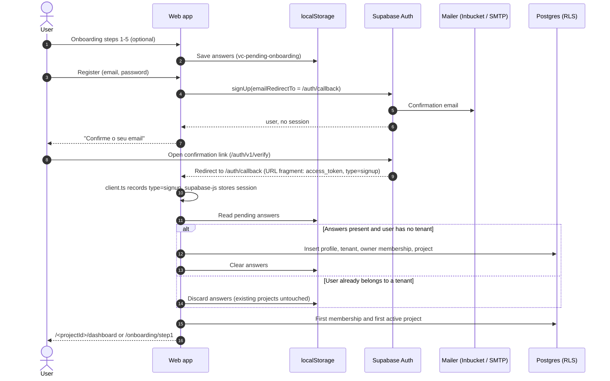
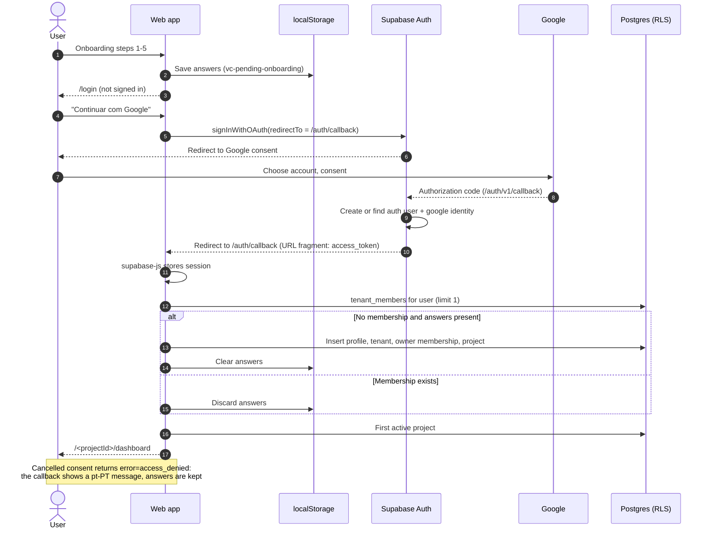
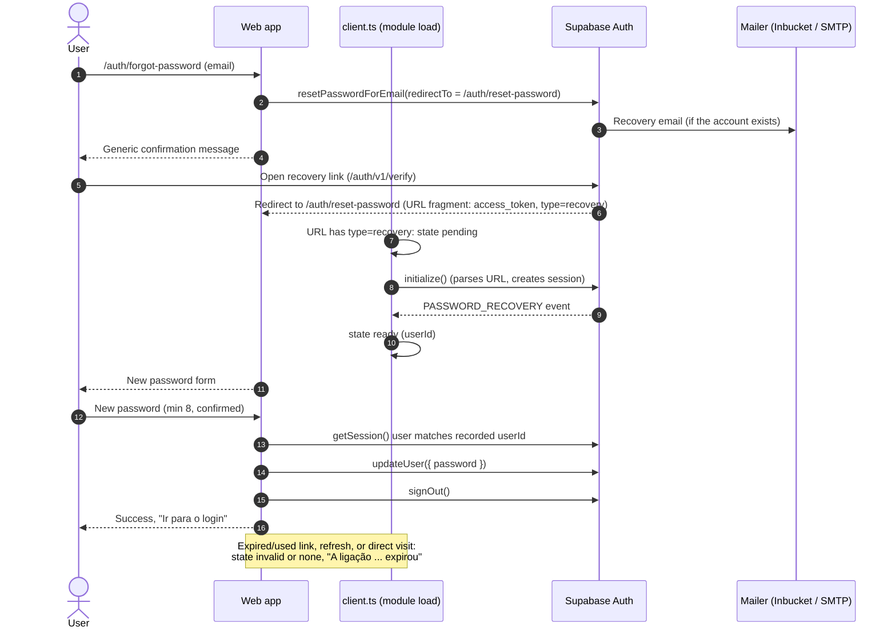

# Authentication, authorization and onboarding

_Last reviewed: 2026-10-21_

Status labels (**Verified / Implemented / Planned / Unknown**) are defined in the [documentation index](../README.md#status-vocabulary).

## Concepts

| Concept | Where it lives | Created by | Notes |
|---|---|---|---|
| **Auth user** | `auth.users`, `auth.identities` (Supabase Auth) | Sign-up (email/password) or first Google sign-in | Identity only. A Google sign-in adds an identity with provider `google`. |
| **Profile** | `public.profiles` (1:1 with `auth.users`, same `id`) | Onboarding completion (`ProfileService.completeOnboarding`) or the profile page (upsert) | Name, phone, city, country, `onboarding_completed_at`, **`plan`**. There is **no database trigger** that creates a profile on sign-up. |
| **Tenant** | `public.tenants` + `public.tenant_members` | Onboarding (`ProfileService.createTenantStructure`) | The authorization boundary. The creator becomes `owner`. |
| **Project** | `public.projects` (belongs to a tenant) | Onboarding (first project) and the project wizard | Carries the onboarding answers (`project_type`, `current_phase`, `goal`, `budget`, …). |

A signed-in user can exist without a profile, tenant or project (for example, after confirming an email on another device). The app sends such users to onboarding.

## Implementation map

| Area | Files |
|---|---|
| Supabase browser client, recovery-session tracker, auth-redirect capture | `apps/web/lib/supabase/client.ts` |
| Session store and auth listener | `apps/web/src/store/authStore.ts`, `src/components/providers/AuthProvider.tsx` |
| Onboarding answers (persisted) | `apps/web/src/store/appContextStore.ts` |
| Onboarding completion, post-login redirect | `apps/web/src/services/profileService.ts` |
| Pages | `app/login`, `app/register`, `app/auth/callback`, `app/auth/forgot-password`, `app/auth/reset-password`, `app/onboarding/step1..5` |
| Logout | `apps/web/components/AppLayout.tsx` ("Sair") |
| Local Auth configuration | `apps/api/supabase/config.toml` (`[auth]`, `[auth.email]`, `[auth.external.google]`) |
| Email templates (pt-PT) | `apps/api/supabase/templates/{confirmation,recovery,email_change}.html` |

## Flow status

| Flow | Status |
|---|---|
| Email/password login | **Verified** |
| Logout | **Verified** |
| Post-login redirects | **Verified** |
| Password recovery | **Verified** (local, Inbucket) |
| Google OAuth sign-up with onboarding | **Verified** once locally (a new Google user completed onboarding and reached the dashboard) |
| Google OAuth for an existing user | **Implemented** — not separately confirmed |
| Email/password registration with email confirmation | **Implemented** — end-to-end validation not confirmed after enabling `enable_confirmations` |
| Resend confirmation email | **Implemented** |
| Production Auth (Site URL, SMTP, Google client) | **Planned** |

## Session handling

- `lib/supabase/client.ts` creates one client with `persistSession: true` and `autoRefreshToken: true`. No `flowType` is set, so supabase-js uses its default **implicit flow**: OAuth, confirmation and recovery links return tokens in the URL fragment, which the client parses on page load (`detectSessionInUrl`, default on).
- The session is stored by supabase-js in `localStorage`. `authStore` also persists `user`, `session` and `initialized` under `auth-store`; this duplicate is a known limitation.
- `AuthProvider` calls `initializeAuth()`, which hydrates `authStore` from `getSession()` and subscribes to `onAuthStateChange`. Pages must wait for `initialized === true` before treating a user as signed out.
- Local configuration: `jwt_expiry = 3600`, refresh-token rotation enabled.
- There is no middleware or route guard. Logged-out users on project pages see empty data (RLS) and are redirected by individual pages.

## Email/password registration and confirmation

**Status: Implemented.** Local confirmation is enabled (`[auth.email] enable_confirmations = true`); confirmation emails appear in Inbucket.

1. The register page validates the email, a minimum password length of **8** (client-side only; the server default may be lower), and matching passwords.
2. It calls `supabase.auth.signUp({ email, password, options: { emailRedirectTo: <origin>/auth/callback } })`.
3. If no session is returned (confirmation required), the page shows **"Confirme o seu email"**. Supabase returns the same response for an already-registered email when confirmation is on, so the page does not reveal existing accounts.
4. If a session is returned (confirmation disabled), onboarding is resumed immediately and the user is redirected.
5. The confirmation link goes through Supabase (`/auth/v1/verify`) and lands on `/auth/callback` with the session in the URL fragment.

Error handling on the register page maps Supabase error codes to pt-PT messages (`weak_password`, `email_address_invalid`, `signup_disabled`, `user_already_exists`/`email_exists` — the last only occurs when confirmation is off — HTTP 429, network errors). Raw Supabase messages are not shown.

## Email/password login

**Status: Verified.**

1. `authStore.signIn()` calls `signInWithPassword`.
2. Errors are mapped to pt-PT: `invalid_credentials` ("Email ou palavra-passe incorretos."), `email_not_confirmed` (with a **"Reenviar email de confirmação"** button calling `supabase.auth.resend({ type: 'signup' })`), `user_banned`, HTTP 429 and network errors.
3. On success: `ProfileService.resumePendingOnboarding()`, then [post-login redirect](#post-login-redirects).

`email_not_confirmed` is only returned when the password is correct, so it does not enable account enumeration.

## Google OAuth

**Status: Verified once locally (new user with onboarding); production Planned.**

1. Login calls `signInWithOAuth({ provider: 'google', options: { redirectTo: <origin>/auth/callback } })`.
2. Onboarding answers survive the full-page redirect because `appContextStore` persists them.
3. Google redirects to Supabase (`/auth/v1/callback`), which redirects to `/auth/callback` with the session.
4. The callback page resumes onboarding and redirects.

Local Google credentials come from `apps/api/supabase/.env` (`SUPABASE_AUTH_EXTERNAL_GOOGLE_CLIENT_ID`, `SUPABASE_AUTH_EXTERNAL_GOOGLE_SECRET`), substituted into `config.toml` by the Supabase CLI at `supabase start`. See [local development](../operations/local-development.md#google-oauth).

## Auth callback (`/auth/callback`)

Used by Google OAuth and email confirmation links.

1. At module load, `client.ts` reads the URL **before** supabase-js clears it and keeps only the link `type` and error code (`getAuthRedirectInfo()`); tokens are never stored or logged.
2. The page awaits `getSession()` (which waits for supabase-js to process the URL).
3. If the URL carried an error, it shows a pt-PT message: `otp_expired` → link expired or already used; `access_denied` → cancelled/not authorized; anything else → generic failure. An error wins over any existing session.
4. Otherwise it shows "Email confirmado…" (`type=signup`) or "Sessão iniciada…", resumes onboarding and redirects.
5. Failures while creating the project or loading projects show **"Tentar novamente"** (retry) and **"Voltar ao login"**. There are no automatic timed redirects.

## Onboarding

**Status: Verified (Google path); Implemented (email paths).**

- `/` (welcome page) → `/onboarding/step1` … `step5`. Each step writes to `appContextStore.pendingOnboardingData`, persisted with a timestamp (`pendingOnboardingSavedAt`).
- Stored values are stable ids (`new-construction`, `house`, `design`, `sell`, …); only display labels are translated.
- **Step 5** saves the answers, then:
  - not signed in → `/login`;
  - signed in (e.g. an account without a project) → completes onboarding directly and redirects.

### How onboarding is completed — `ProfileService.resumePendingOnboarding()`

Called by login, register (confirmation off), the auth callback and step 5. Returns `completed`, `skipped` or `none`; throws on failure.

1. No answers → `none`. Answers older than **7 days** or without `projectType` are discarded → `none`.
2. Looks up `tenant_members` for the user with `limit(1)`. If a membership exists → discards the answers and returns `skipped`. **Existing tenants and projects are never modified.**
3. Otherwise `completeOnboarding()`:
   - inserts or updates the **profile** (`full_name` from Google metadata or the email prefix, `onboarding_completed_at`); `plan` is never sent and defaults to `free`;
   - `createTenantStructure()` inserts the **tenant** (`owner_user_id = user`), the **owner membership** (allowed by the `tenant_members_bootstrap_owner` RLS policy) and the first **project** with the onboarding fields.
4. Clears the answers → `completed`.

### Duplicate prevention (what the code guarantees)

| Mechanism | Protects against |
|---|---|
| Membership check before creating anything | Running onboarding again for a user who already has a tenant (e.g. stale answers, existing Google user) |
| One in-flight promise per page (`resumeInFlight`) | React Strict Mode double effects and repeated clicks in the same tab |
| Answers cleared only after success | Losing answers when creation fails (the user can retry) |

**Not guaranteed:**

- Tenant creation is three separate inserts, **not a transaction**. If the membership insert fails after the tenant insert, an orphan tenant remains; a retry creates another tenant.
- Two tabs or devices completing onboarding at the same moment could both pass the membership check. There is no database uniqueness constraint (e.g. one owned tenant per user).

## Post-login redirects

`ProfileService.getPostLoginRedirect()` (**Verified**):

| Situation | Destination |
|---|---|
| Member of a tenant with an active project | `/<first active project id>/dashboard` |
| No membership, or a tenant with no active project | `/onboarding/step1` |
| User or lookup query fails | `null` → the caller shows an error and does not redirect |

There are no user-supplied redirect parameters (`?next=` etc.), so there is no open-redirect surface. OAuth `redirectTo` and `emailRedirectTo` are built from `window.location.origin` and must match the Supabase redirect allowlist.

## Password recovery

**Status: Verified (local).**

- `/login` → "Esqueceu-se da palavra-passe?" → `/auth/forgot-password` calls `resetPasswordForEmail(email, { redirectTo: <origin>/auth/reset-password })`.
- The page always shows the same generic message, including for HTTP 429, so it does not reveal whether an account exists.
- `/auth/reset-password` only shows the form when supabase-js emits **`PASSWORD_RECOVERY`**. Because auth-js emits that event once (from a `setTimeout` during initialization), `client.ts` subscribes at module load and records `{ status: 'ready', userId }`. A normal signed-in session never unlocks the form.
- Before saving, the page checks that the current session belongs to the recorded user. After `updateUser({ password })` it clears the recovery state, signs out and asks the user to log in with the new password.

Mapped errors: `same_password`, `weak_password`, expired session (HTTP 401/403, `AuthSessionMissingError`), network.

## Logout

**Status: Verified.** "Sair" (desktop and mobile menus) calls `authStore.signOut()`:

- On success: clears the persisted `user`/`session` and performs a **full navigation** to `/login` (`window.location.replace`), which discards all in-memory stores so no previous user's data stays visible.
- On failure (e.g. offline): shows a pt-PT error and keeps the user signed in. The button is disabled while signing out.

## Plans and authorization

- `profiles.plan` (`free` | `pro` | `premium`, default `free`) drives server-side AI quotas and export gating. Since migration `20261021120000_protect_profiles_plan.sql`, the `authenticated` role can insert/update only explicitly granted profile columns, **not `plan`**. Plans are changed manually in the SQL Editor. See [data and storage](data-and-storage.md#plans-and-ai-quotas).
- New client-editable profile columns must be added to that migration's column grants in a new migration; otherwise writes fail with `42501`.

## Known edge cases and deferred improvements

| Edge case | Current behaviour |
|---|---|
| Confirmation link opened on another device/browser | User is signed in but the onboarding answers are not there → `/onboarding/step1`. |
| Tenant exists but has no active project (e.g. all archived) | Redirect to onboarding; step 5 returns `skipped` (membership exists) and redirects to onboarding again. **Possible loop**; not handled. |
| User without a profile row | AI quota RPCs raise "User profile not found"; profile is created by onboarding or the profile page. |
| Recovery link opened, form not submitted | The recovery session is a normal signed-in session until the user signs out. |
| Reset page refreshed | Shows "invalid link" (the event does not repeat); a new link is needed. |
| Recovery/confirmation `redirectTo` on `127.0.0.1:3000` locally | Supabase allows redirect URLs on the Site URL host (`localhost`) [verify]; use `http://localhost:3000`. |
| Google consent screen in "Testing" | Only listed test users can sign in. |

Deferred improvements: PKCE flow, middleware route guards, removing the duplicated session in `authStore`, server-side minimum password length, atomic tenant creation (database function), account deletion.

Production requirements (Site URL, redirect allowlist, SMTP, templates, Google client) are in [production setup](../operations/production-setup.md).
