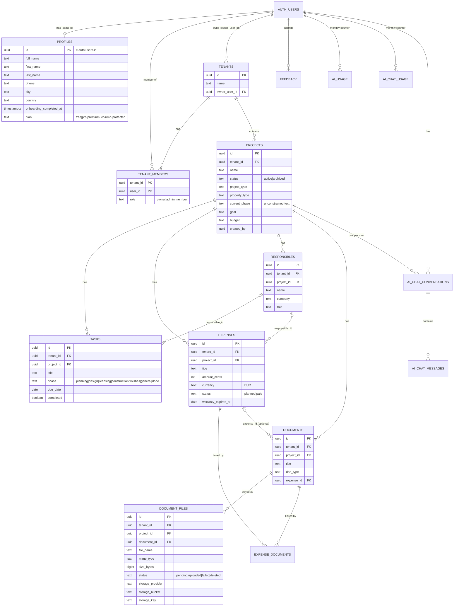
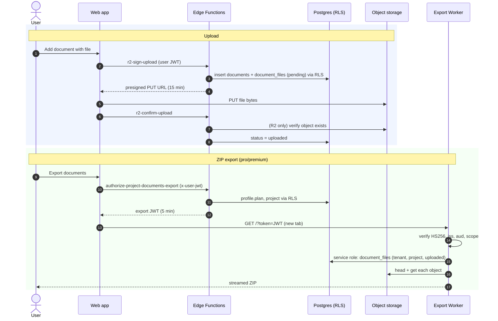

# Data, tenancy and document storage

_Last reviewed: 2026-10-21_

Status labels (**Verified / Implemented / Planned / Unknown**) are defined in the [documentation index](../README.md#status-vocabulary).

The source of truth is `apps/api/supabase/migrations/` (27 migrations, from `20250219210000_init_core.sql` to `20261021120000_protect_profiles_plan.sql`).

> **Deployment status of migrations.** No production database exists yet, so **no migration has been applied to production**. Whether the newest migration (`20261021120000_protect_profiles_plan.sql`) has been applied to the local database is **Unknown** — check with `supabase migration list` (local, read-only).

## Core entities



Notes:

- Every project-level table carries both `tenant_id` and `project_id`; all foreign keys to `tenants`/`projects` use `ON DELETE CASCADE`.
- `tasks` has two boolean columns, `is_done` (original) and `completed` (added in `20260421100000`).
- `document_files` keeps legacy `r2_bucket`/`r2_key` columns next to the provider-neutral `storage_*` columns; code reads `storage_*` first.
- `projects.current_phase` uses a different vocabulary from `tasks.phase`; see `CLAUDE.md` before mapping phases.
- A document may have **no file** (the add-document form allows it); such documents cannot be downloaded or exported.
- AI reservation tables (`ai_reservations`, `ai_chat_reservations`) and `feedback` are omitted from the diagram for readability.

## Multi-tenancy and RLS

RLS is enabled on every table. The core rule is **membership of the row's tenant**, implemented by:

```sql
public.is_tenant_member(tid uuid)  -- SECURITY DEFINER, row_security = off
```

`SECURITY DEFINER` with `row_security = off` avoids recursion when `tenant_members` policies themselves call the function (`20250220020000_fix_rls_recursion.sql`).

| Table(s) | SELECT | INSERT | UPDATE / DELETE |
|---|---|---|---|
| `profiles` | own row | own row; **column grants exclude `plan`** | own row (UPDATE); column grants exclude `plan` |
| `tenants` | members | any user, as `owner_user_id = auth.uid()` | owner only |
| `tenant_members` | members of the tenant | owner/admin of the tenant; **bootstrap**: a user may add themselves as `owner` of a tenant they own | owner/admin |
| `projects` | members | members, `created_by = auth.uid()` | members |
| `tasks` | members | members, `created_by` null or self, **project must belong to the same tenant** | members |
| `expenses`, `documents`, `document_files` | members | members, `created_by` null or self | members |
| `responsibles`, `expense_documents` | members | members | members |
| `feedback` | own rows | own rows | — |
| `ai_usage`, `ai_reservations`, `ai_chat_*` | own rows | denied (`WITH CHECK (false)`) | denied |

Consequences to keep in mind:

- **RLS restricts by tenant, not by project.** Queries must always filter by `project_id`.
- Inserts into `expenses`, `documents`, `responsibles`, etc. do not check that `project_id` belongs to the same tenant (only `tasks` does). Cross-tenant reads remain impossible because SELECT is tenant-scoped.
- Any signed-in user can create tenants and projects; project limits per plan are **not** enforced by the database.
- `public.debug_auth_context()` (security invoker, returns the caller's own JWT claims) is granted to `authenticated` — harmless, but a candidate for removal.

Privileged database access:

| Who | Key | Used for |
|---|---|---|
| Browser | anon key + user JWT | Everything, through RLS |
| Edge Functions | user JWT (RLS) by default; service role **only** for AI quota RPCs, after `requireUser()` | Presigning, deletion, exports, AI |
| Export Worker | service role, after verifying the export JWT | Reading `document_files` for one tenant/project |
| SQL Editor (database owner) | — | Manual plan changes, administration |

## Plans and AI quotas

| Item | free | pro | premium | Enforced where |
|---|---|---|---|---|
| AI checklist suggestions / month | 2 | 100 | 100 | DB: `get_ai_quota_limit`, `reserve_ai_generation_service` |
| AI chat messages / month | 10 | 100 | 300 | DB: `get_ai_chat_quota_limit`, `reserve_ai_chat_generation_service` |
| Document ZIP export, expenses Excel | ✗ | ✓ | ✓ | Edge Functions (`profile.plan === 'free'` → 403) |
| Active projects, documents per project, other features | per `projectStore` entitlements | | | **Frontend only** (UI gating) |

- AI flow: reserve (service-role RPC, row lock on the profile) → call OpenAI → finalize (increments the monthly counter) or release on failure. Pending reservations expire after 5 minutes.
- Quotas are **per user**, not per tenant. Export gating checks the **requesting user's** plan.
- `apps/web/docs/billing-and-plans.md` describes Pro AI credits as "unlimited (fair use)"; the database limits Pro to 100/month. Treat the database values as authoritative.

**`profiles.plan` protection** (`20261021120000_protect_profiles_plan.sql`): table-wide `INSERT`/`UPDATE` were revoked from `anon` and `authenticated` and re-granted only on `id, full_name, avatar_url, first_name, last_name, phone, city, country, onboarding_completed_at`. RLS policies are unchanged. Effects:

- A client update or insert that includes `plan` fails with `42501` (permission denied). New profiles get the default `free`.
- The SQL Editor (database owner) and the service role can still change plans. Manual grant, one user at a time:

  ```sql
  begin;
  update public.profiles set plan = 'pro' where id = '<user-uuid>' returning id, plan;
  commit;
  ```

## Document storage

### Metadata vs binary data

| Data | Location |
|---|---|
| Document metadata (title, type, phase/category, supplier, dates, expense link) | `documents` (Postgres, RLS) |
| File records (name, MIME type, size, status, storage location) | `document_files` (Postgres, RLS) |
| File bytes | Object storage: local Supabase Storage (S3 API) or Cloudflare R2 |

Object key layout (written by `r2-sign-upload`):

```
<tenant_id>/<project_id>/<document_id>/<document_file_id>/<sanitized_file_name>
```

`document_files.status` lifecycle: `pending` (URL issued) → `uploaded` (confirmed) → `deleted` (tombstone during deletion). Stale `pending` rows can be marked `failed` by `cleanup-pending-uploads`.

### Upload flow

**Status: Verified (local_s3).** Allowed types: PDF, JPEG, PNG. Maximum 20 MB (validated by the function from the declared size).

1. Browser → `r2-sign-upload` with `tenant_id`, `project_id`, document metadata and file descriptors.
2. The function (user-scoped client, so RLS applies) inserts the `documents` row (unless `document_id` is given), inserts `document_files` as `pending`, writes the storage key and returns a presigned **PUT** URL valid for 15 minutes.
3. Browser PUTs the file directly to storage.
4. Browser → `r2-confirm-upload`. For R2 the function checks the object exists, then sets `status = 'uploaded'`. For `local_s3` the existence check is skipped.

Downloads: `r2-sign-download` returns a presigned **GET** URL (10 minutes) for a file whose status is `uploaded`.

### Document deletion

**Status: Verified (local_s3).** `delete-document` (`POST { document_id, project_id }`):

1. `requireUser()`; UUID validation.
2. Loads the document through the user-scoped client (RLS). Not found or another tenant → **404 with `code: "DOCUMENT_NOT_FOUND"`** (the frontend treats only this as "already deleted").
3. Loads all its `document_files` (any status) and validates every storage location: the key must start with `<tenant>/<project>/<document>/<file>/` and the bucket must equal the configured bucket. Any mismatch → **409 `STORAGE_LOCATION_UNTRUSTED`** before anything changes.
4. Marks the files `deleted` (tombstone), so downloads and exports stop immediately.
5. Deletes each object with a presigned DELETE (10 s timeout). 204/200/404 count as deleted. Any failure → **502 `STORAGE_DELETE_FAILED`**; rows are kept for a retry.
6. Deletes the `documents` row; `document_files` and `expense_documents` cascade.

Objects are removed before the rows that locate them, so failures do not orphan files. **Known gap:** a presigned PUT issued before deletion (valid 15 minutes) can still create an object after the document is deleted.

Local networking detail: Edge Functions run in Docker, so server-side storage requests use `S3_INTERNAL_ENDPOINT_URL` (`http://kong:8000/storage/v1/s3`) and are signed for the host Storage reconstructs from Kong's forwarded headers (`kong:54321`). Browser-facing URLs keep using `S3_ENDPOINT_URL`. For R2 both endpoints are identical. See `functions/delete-document/index.ts`.

### ZIP export

**Status: Implemented; local manual validation not confirmed.**

1. Browser → `authorize-project-documents-export` (`export_type: "documents"` or `"full"`). The function checks the caller's plan (not `free`) and project access (RLS), then signs an **HS256 export JWT** with `EXPORT_JWT_SECRET`: issuer `visao-clara-edge`, audience `visao-clara-worker`, `scope` (`documents_export` | `full_export`), `project_id`, `tenant_id` (from the project row), 5-minute expiry.
2. Browser opens `<NEXT_PUBLIC_WORKER_URL>/?token=<jwt>` in a new tab.
3. The Worker verifies the token, then with the **service-role** key selects `document_files` where `tenant_id`, `project_id` match the token and `status = 'uploaded'`.
4. No files (documents export) → `404 NO_FILES` JSON. Otherwise it checks every object exists (`409 FILE_MISSING` if not) and streams a ZIP (`documentos/<file name>`, stored without compression).
5. For `full_export` it first fetches `get-project-expenses-xlsx?token=…&project_id=…` and adds `visao-clara-despesas.xlsx`.

**Risk — full export:** `get-project-expenses-xlsx` keeps the default `verify_jwt = true`, but the Worker sends no `Authorization` header. The Supabase gateway is therefore expected to reject the request (401), which the Worker reports as `502 XLSX_FETCH_FAILED`. Fixing this requires setting `verify_jwt = false` for that function (it already verifies the export JWT itself) — a configuration change that needs approval.



### Storage security boundaries

- Buckets must be **private**; all access is through presigned URLs (PUT 15 min, GET 10 min) or the Worker.
- Storage credentials (`S3_*`, `VC_R2_*`) exist only in Edge Function and Worker environments.
- File records are read through RLS before any URL is signed.
- **Gaps:**
  - Tenant members can update `document_files.storage_key`/`storage_bucket` directly (RLS allows UPDATE). `delete-document` validates the key prefix; **`r2-sign-download` does not**. A member who knows another tenant's full key (four UUIDs + file name) could obtain a download URL for it. Recommended fix: the same prefix check in `r2-sign-download`, or revoking UPDATE on storage columns.
  - The presigned PUT does not sign `Content-Length`, so the 20 MB limit is not enforced by storage.
  - `r2-confirm-upload` performs a full GET to check existence on R2 (a HEAD would suffice).
  - The export JWT travels in the query string, so it can appear in logs (mitigated by the 5-minute expiry).
  - Edge Functions return `Access-Control-Allow-Origin: *` (acceptable because authentication uses bearer tokens, not cookies).

Production storage configuration (bucket, CORS, API token, Worker binding) is covered in [production setup](../operations/production-setup.md#9-cloudflare-r2).
