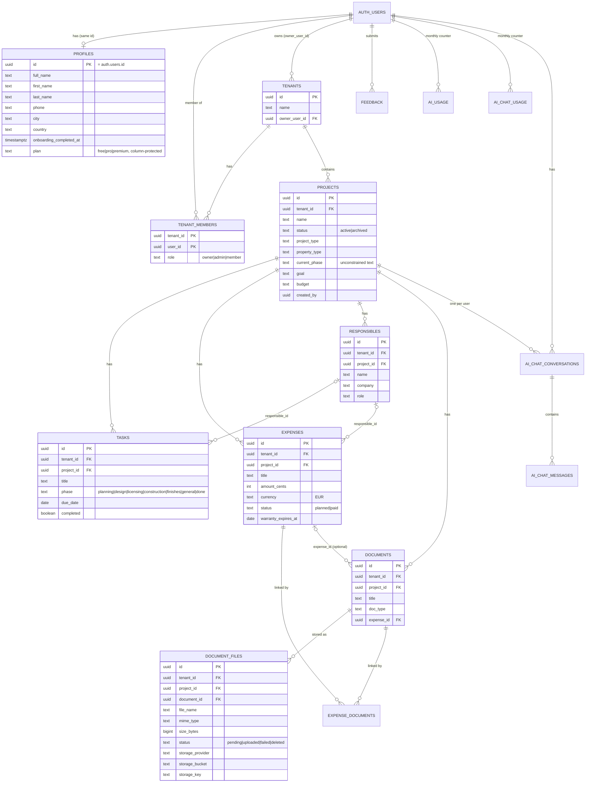
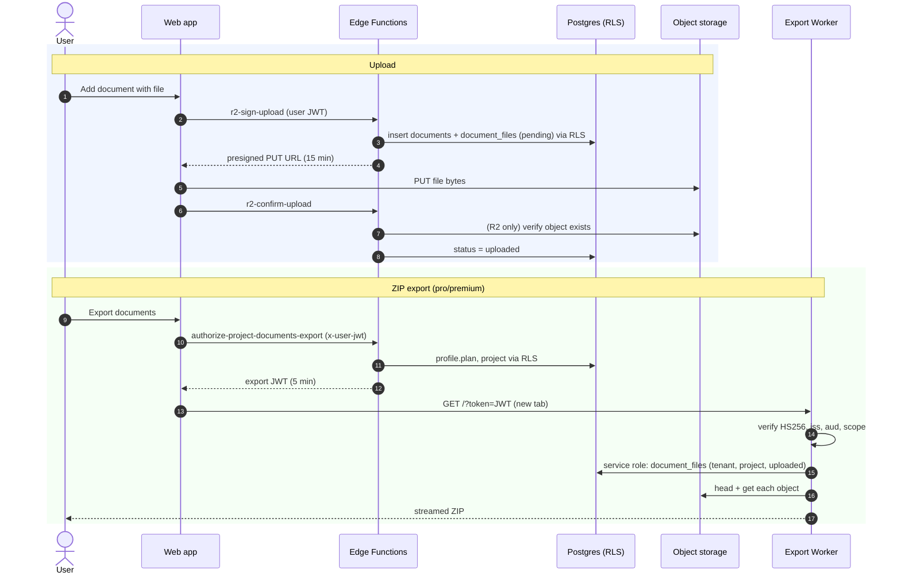

# Data, tenancy and document storage

_Last reviewed: 2026-10-21_

Status labels (**Verified / Implemented / Planned / Unknown**) are defined in the [documentation index](../README.md#status-vocabulary).

The source of truth is `apps/api/supabase/migrations/` (30 migrations, from `20250219210000_init_core.sql` to `20261106100000_harden_document_files_storage.sql`).

> **Deployment status of migrations (checked 2026-11-16 with `supabase migration list`, read-only).** LOCAL: all 30 applied. DEV (`visao-clara-dev`): 29 applied; `20261106100000_harden_document_files_storage` (S1) is missing. PROD (`visao-clara-prod`): the project exists with no Edge Functions and no secrets; its schema was **not verified** and is assumed empty, so assume no migration is applied.

## Core entities



Notes:

- Every project-level table carries both `tenant_id` and `project_id`; all foreign keys to `tenants`/`projects` use `ON DELETE CASCADE`.
- `tasks` has two boolean columns, `is_done` (original) and `completed` (added in `20260421100000`).
- `document_files` keeps legacy `r2_bucket`/`r2_key` columns next to the provider-neutral `storage_*` columns; code reads `storage_*` first.
- `projects.current_phase` uses a different vocabulary from `tasks.phase`; see `CLAUDE.md` before mapping phases.
- A document may have **no file** (the add-document form allows it); such documents cannot be downloaded or exported.
- AI reservation tables (`ai_reservations`, `ai_chat_reservations`) and `feedback` are omitted from the diagram for readability.

## Multi-tenancy and RLS

RLS is enabled on every table. The core rule is **membership of the row's tenant**, implemented by:

```sql
public.is_tenant_member(tid uuid)  -- SECURITY DEFINER, row_security = off
```

`SECURITY DEFINER` with `row_security = off` avoids recursion when `tenant_members` policies themselves call the function (`20250220020000_fix_rls_recursion.sql`).

| Table(s) | SELECT | INSERT | UPDATE / DELETE |
|---|---|---|---|
| `profiles` | own row | own row; **column grants exclude `plan`** | own row (UPDATE); column grants exclude `plan` |
| `tenants` | members | any user, as `owner_user_id = auth.uid()` | owner only |
| `tenant_members` | members of the tenant | owner/admin of the tenant; **bootstrap**: a user may add themselves as `owner` of a tenant they own | owner/admin |
| `projects` | members | members, `created_by = auth.uid()` | members |
| `tasks` | members | members, `created_by` null or self, **project must belong to the same tenant** | members |
| `expenses`, `documents`, `document_files` | members | members, `created_by` null or self | members |
| `responsibles`, `expense_documents` | members | members | members |
| `feedback` | own rows | own rows | — |
| `ai_usage`, `ai_reservations`, `ai_chat_*` | own rows | denied (`WITH CHECK (false)`) | denied |

Consequences to keep in mind:

- **RLS restricts by tenant, not by project.** Queries must always filter by `project_id`.
- Inserts into `expenses`, `documents`, `responsibles`, etc. do not check that `project_id` belongs to the same tenant (only `tasks` does). Cross-tenant reads remain impossible because SELECT is tenant-scoped.
- Any signed-in user can create tenants and projects; project limits per plan are **not** enforced by the database.
- `public.debug_auth_context()` still exists but no API role can execute it (since `20261022100000`); a candidate for removal.

Table privileges (since `20261022100000_explicit_api_grants.sql`):

- Grants are explicit and minimal, so the schema no longer depends on Supabase's default privileges and behaves the same whether a project's "Automatically expose new tables" setting is on or off.
- `anon` has no table or function privileges.
- `authenticated` has only what the app uses: no DELETE except on `documents`, `document_files` UPDATE limited to `status, uploaded_at, r2_key, storage_key`, `feedback` INSERT only, SELECT only on the AI chat tables, nothing on `expense_documents` and the AI usage/reservation tables.
- `service_role` can only SELECT/INSERT `ai_chat_conversations` and SELECT `expenses` and `document_files`; the quota RPCs run as their owner.
- New tables, sequences and functions in `public` start with no privileges for these roles: **every new table, column or function used by the app needs an explicit `GRANT` in its migration.**

Privileged database access:

| Who | Key | Used for |
|---|---|---|
| Browser | anon key + user JWT | Everything, through RLS |
| Edge Functions | user JWT (RLS) by default; service role **only** for AI quota RPCs, after `requireUser()` | Presigning, deletion, exports, AI |
| Export Worker | service role, after verifying the export JWT | Reading `document_files` for one tenant/project |
| SQL Editor (database owner) | — | Manual plan changes, administration |

## Plans and AI quotas

| Item | free | pro | premium | Enforced where |
|---|---|---|---|---|
| AI checklist suggestions / month | 2 | 100 | 100 | DB: `get_ai_quota_limit`, `reserve_ai_generation_service` |
| AI chat messages / month | 10 | 100 | 300 | DB: `get_ai_chat_quota_limit`, `reserve_ai_chat_generation_service` |
| Document ZIP export, expenses Excel | ✗ | ✓ | ✓ | Edge Functions (`profile.plan === 'free'` → 403) |
| Active projects, documents per project, other features | per `projectStore` entitlements | | | **Frontend only** (UI gating) |

- AI flow: reserve (service-role RPC, row lock on the profile) → call OpenAI → finalize (increments the monthly counter) or release on failure. Pending reservations expire after 5 minutes.
- Quotas are **per user**, not per tenant. Export gating checks the **requesting user's** plan.
- `apps/web/docs/billing-and-plans.md` describes Pro AI credits as "unlimited (fair use)"; the database limits Pro to 100/month. Treat the database values as authoritative.

**`profiles.plan` protection** (`20261021120000_protect_profiles_plan.sql`): table-wide `INSERT`/`UPDATE` were revoked from `anon` and `authenticated` and re-granted only on `id, full_name, avatar_url, first_name, last_name, phone, city, country, onboarding_completed_at`. RLS policies are unchanged. Effects:

- A client update or insert that includes `plan` fails with `42501` (permission denied). New profiles get the default `free`.
- The SQL Editor (database owner) and the service role can still change plans. Manual grant, one user at a time:

  ```sql
  begin;
  update public.profiles set plan = 'pro' where id = '<user-uuid>' returning id, plan;
  commit;
  ```

## Document storage

### Metadata vs binary data

| Data | Location |
|---|---|
| Document metadata (title, type, phase/category, supplier, dates, expense link) | `documents` (Postgres, RLS) |
| File records (name, MIME type, size, status, storage location) | `document_files` (Postgres, RLS) |
| File bytes | Object storage: local Supabase Storage (S3 API) or Cloudflare R2 |

Object key layout (written by `r2-sign-upload`):

```
<tenant_id>/<project_id>/<document_id>/<document_file_id>/<sanitized_file_name>
```

`document_files.status` lifecycle: `pending` (URL issued) → `uploaded` (confirmed) → `deleted` (tombstone during deletion). Stale `pending` rows can be marked `failed` by `cleanup-pending-uploads`.

### Upload flow

**Status: Verified (local_s3).** Allowed types: PDF, JPEG, PNG. Maximum 20 MB (validated by the function from the declared size).

1. Browser → `r2-sign-upload` with `tenant_id`, `project_id`, document metadata and file descriptors.
2. The function (user-scoped client, so RLS applies) inserts the `documents` row (unless `document_id` is given), inserts `document_files` as `pending`, writes the storage key and returns a presigned **PUT** URL valid for 15 minutes.
3. Browser PUTs the file directly to storage.
4. Browser → `r2-confirm-upload`. For R2 the function checks the object exists, then sets `status = 'uploaded'`. For `local_s3` the existence check is skipped.

Downloads: `r2-sign-download` returns a presigned **GET** URL (10 minutes) for a file whose status is `uploaded`.

### Document deletion

**Status: Verified (local_s3).** `delete-document` (`POST { document_id, project_id }`):

1. `requireUser()`; UUID validation.
2. Loads the document through the user-scoped client (RLS). Not found or another tenant → **404 with `code: "DOCUMENT_NOT_FOUND"`** (the frontend treats only this as "already deleted").
3. Loads all its `document_files` (any status) and validates every storage location: the key must start with `<tenant>/<project>/<document>/<file>/` and the bucket must equal the configured bucket. Any mismatch → **409 `STORAGE_LOCATION_UNTRUSTED`** before anything changes.
4. Marks the files `deleted` (tombstone), so downloads and exports stop immediately.
5. Deletes each object with a presigned DELETE (10 s timeout). 204/200/404 count as deleted. Any failure → **502 `STORAGE_DELETE_FAILED`**; rows are kept for a retry.
6. Deletes the `documents` row; `document_files` and `expense_documents` cascade.

Objects are removed before the rows that locate them, so failures do not orphan files. **Known gap:** a presigned PUT issued before deletion (valid 15 minutes) can still create an object after the document is deleted.

Local networking detail: Edge Functions run in Docker, so server-side storage requests use `S3_INTERNAL_ENDPOINT_URL` (`http://kong:8000/storage/v1/s3`) and are signed for the host Storage reconstructs from Kong's forwarded headers (`kong:54321`). Browser-facing URLs keep using `S3_ENDPOINT_URL`. For R2 both endpoints are identical. See `functions/delete-document/index.ts`.

### ZIP export

**Status: Implemented. Unit-tested (token verification, authorization, Worker behaviour) and run end to end locally under the Workers runtime on 2026-11-16; not deployed to DEV or PROD.**

1. Browser → `authorize-project-documents-export` (`export_type: "documents"` or `"full"`). The function checks the caller's plan (not `free`) and project access (RLS), then signs an **HS256 export JWT** with `EXPORT_JWT_SECRET`: issuer `visao-clara-edge`, audience `visao-clara-worker`, `scope` (`documents_export` | `full_export`), `project_id`, `tenant_id` (from the project row), 5-minute expiry.
2. Browser opens `<NEXT_PUBLIC_WORKER_URL>/?token=<jwt>` in a new tab.
3. The Worker verifies the token, then with the **service-role** key selects `document_files` where `tenant_id`, `project_id` match the token and `status = 'uploaded'`.
4. No files (documents export) → `404 NO_FILES` JSON. Otherwise it checks every object exists (`409 FILE_MISSING` if not) and streams a ZIP (`documentos/<file name>`, stored without compression).
5. For `full_export` it first fetches `get-project-expenses-xlsx?token=…&project_id=…` and adds `visao-clara-despesas.xlsx`.

**Full export and `verify_jwt` (approved 2026-11-16):** `get-project-expenses-xlsx` keeps the default `verify_jwt = true`, but the Worker sends no `Authorization` header. Verified against the local gateway on 2026-11-16: the gateway answers 401 "Missing authorization header" before the function runs, which the Worker reports as `502 XLSX_FETCH_FAILED`. The gateway also accepts the public anon key, after which the function itself rejects a forged export token, so the gateway check adds no authentication here; the function verifies the export JWT itself (issuer, audience, HS256 only, expiry, UUID claims, scope, project binding; `_shared/export_access.ts`). `config.toml` now sets `verify_jwt = false` for that one function (approved 2026-11-16, no other function changed), which takes effect when it is deployed. Guarded by `_tests/get_project_expenses_xlsx_test.ts` (real handler) and `_tests/verify_jwt_config_test.ts`; see `docs/operations/production-setup.md`, section 4.

Invalid, expired and forged export tokens now return 401 from both the Worker and the function (they used to return 500, because jose's error messages do not contain "JWT" or "token"); a token with a scope the endpoint does not serve returns 403.



### Storage security boundaries

- Buckets must be **private**; all access is through presigned URLs (PUT 5 min, GET 10 min) or the Worker.
- Storage credentials (`S3_*`, `VC_R2_*`) exist only in Edge Function and Worker environments.
- File records are read through RLS before any URL is signed.
- **Closed by S1/S2:** the storage identity (`<tenant>/<project>/<document>/<file>/<name>`, bucket and provider from server config) is verified by `r2-sign-download`, `r2-confirm-upload`, `delete-document` and the Worker; clients can no longer write `document_files`; the PUT signs `Content-Type`, `Content-Length` and (R2) `If-None-Match`; confirm verifies the stored object (HEAD and file signature) before marking it `uploaded`.
- **Remaining gaps:**
  - `local_s3` ignores `If-None-Match` (no overwrite protection in development only).
  - Abandoned uploads are not cleaned up automatically (`cleanup-pending-uploads` is not scheduled).
  - The export JWT travels in the query string, so it can appear in logs (mitigated by the 5-minute expiry).
  - Edge Functions return `Access-Control-Allow-Origin: *` (acceptable because authentication uses bearer tokens, not cookies).

Production storage configuration (bucket, CORS, API token, Worker binding) is covered in [production setup](../operations/production-setup.md#9-cloudflare-r2).
