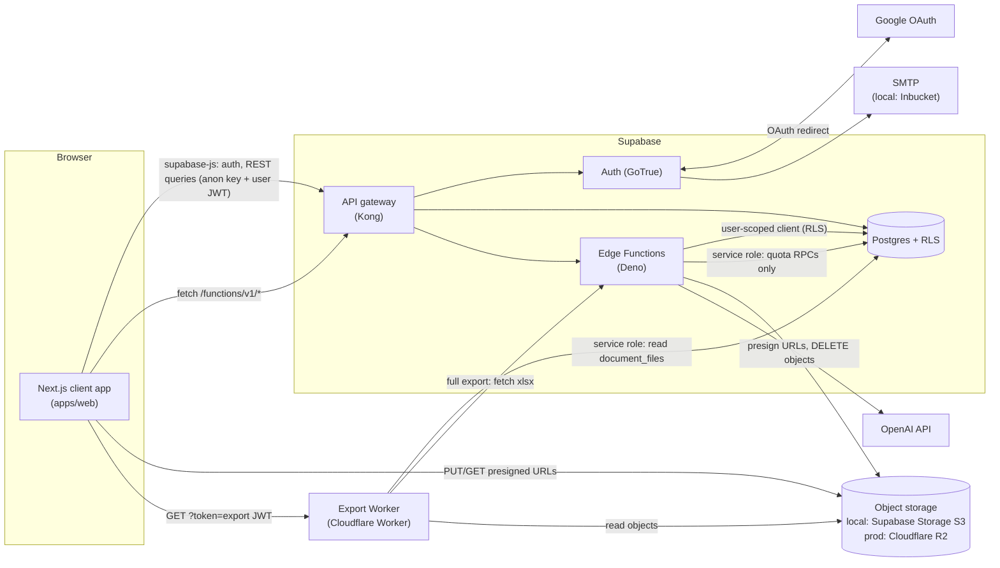
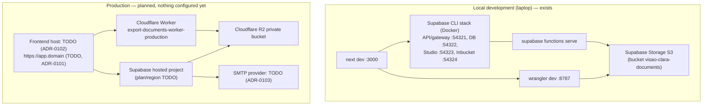

# System overview

_Last reviewed: 2026-10-21_

Status labels (**Verified / Implemented / Planned / Unknown**) are defined in the [documentation index](../README.md#status-vocabulary).

## Purpose and scope

Visão Clara helps homeowners and small investors manage a construction or renovation project. Per project, a user manages:

- a **checklist** of tasks grouped by phase;
- **expenses** (amounts stored as integer cents, EUR);
- **documents** (metadata plus uploaded PDF/JPEG/PNG files);
- **responsáveis** — contractors and other contacts;
- **exports** — an Excel spreadsheet of expenses and a ZIP of documents;
- **AI features** — checklist suggestions and a chat assistant, limited by monthly quotas per plan.

All user-facing text is European Portuguese (pt-PT). The first release is a private beta for roughly 5–20 invited users. Paid subscriptions are out of scope; plans (`free`, `pro`, `premium`) exist and are assigned manually.

## Monorepo structure

```
visao-clara/
├── apps/
│   ├── web/                      Next.js frontend (own pnpm lockfile and node_modules)
│   │   ├── app/                  App Router pages (all client components)
│   │   │   └── [projectId]/      Project-scoped routes; most pages wrap app/<page>/page.tsx
│   │   ├── components/           Feature components, modals, AppLayout, components/ui/*
│   │   ├── lib/supabase/client.ts  The single browser Supabase client
│   │   └── src/                  Zustand stores, providers, services, domain types (src/mocks)
│   └── api/
│       ├── supabase/
│       │   ├── config.toml       Local Supabase configuration
│       │   ├── migrations/       SQL migrations (schema + RLS)
│       │   ├── functions/        Deno Edge Functions (+ _shared helpers)
│       │   └── templates/        pt-PT Auth email templates
│       └── cloudflare-workers/export-documents-worker/   ZIP export Worker (npm + wrangler)
├── packages/                     Empty
├── docs/                         This documentation
└── CLAUDE.md                     Contributor and AI-assistant guidelines
```

The root `package.json` declares `pnpm@10.19.0` and has `dev:web`/`build:web`/`lint:web` scripts, but the root has no `node_modules`; commands are run from `apps/web` (see [local development](../operations/local-development.md)).

## Components

### Frontend — `apps/web` (Implemented; production hosting Planned)

- **Next.js 16.1.1 (App Router), React 19.2.3, TypeScript (strict), Tailwind CSS v4.**
- **Every page and provider is a client component** (`'use client'`). There are no Server Components with data access, no Server Actions, no route handlers and no `middleware.ts`/`proxy.ts`. The Next.js server only serves pages and JavaScript; all data access happens from the browser.
- **State:** Zustand stores in `src/store/`:
  - `projectStore` — projects and per-project tasks, expenses, documents, responsáveis, profile, billing/entitlements. Not persisted.
  - `authStore` — Supabase user/session; persisted to `localStorage` key `auth-store`.
  - `appContextStore` — onboarding answers; persisted to `localStorage` key `vc-pending-onboarding` (answers only).
- **Data loading:** `DataProvider` (root layout) loads the profile and projects; `app/[projectId]/layout.tsx` loads the project's tasks, expenses, responsáveis and documents with explicit `idle | loading | success | error` status per project.
- **Routing:** project pages live at `/<projectId>/<page>`. There is no route-level auth guard; pages redirect to `/login` individually. Security is enforced by RLS and Edge Functions, never by the frontend.
- **Build:** `pnpm build` succeeds (verified 2026-10-21). TypeScript reports 0 errors.

### Supabase — `apps/api/supabase` (Implemented locally; production Planned)

| Service | Responsibility |
|---|---|
| **Postgres + RLS** | All application data. Every table has RLS enabled; tenant isolation via `is_tenant_member(tenant_id)`. See [data and storage](data-and-storage.md). |
| **Auth (GoTrue)** | Email/password, Google OAuth, email confirmation, password recovery. See [authentication](authentication.md). |
| **Edge Functions (Deno)** | Operations that need secrets or privileges: presigned storage URLs, document deletion, export authorization, Excel generation, AI calls with quota enforcement. |
| **Storage (local only)** | In local development, Supabase Storage's S3-compatible API stands in for Cloudflare R2. |
| **Inbucket (local only)** | Captures Auth emails at `http://127.0.0.1:54324`. |

Edge Functions:

| Function | Purpose | Caller | Auth |
|---|---|---|---|
| `r2-sign-upload` | Creates `documents`/`document_files` rows, returns presigned PUT URL(s) | Browser | `verify_jwt=false`, `requireUser()` |
| `r2-confirm-upload` | Marks a file `uploaded` (R2: checks the object exists) | Browser | `verify_jwt=false`, `requireUser()` |
| `r2-sign-download` | Returns a presigned GET URL for an uploaded file | Browser | `verify_jwt=false`, `requireUser()` |
| `cleanup-pending-uploads` | Marks the caller's stale `pending` files as `failed` | Browser/manual | `verify_jwt=false`, `requireUser()` |
| `delete-document` | Deletes stored objects, then the document rows | Browser | gateway + `requireUser()` (`x-user-jwt`) |
| `authorize-project-documents-export` | Issues a 5-minute export JWT (non-free plans) | Browser | gateway + `requireUser()` (`x-user-jwt`) |
| `export-project-expenses` | Excel export of expenses (non-free plans) | Browser | gateway + `requireUser()` (`x-user-jwt`) |
| `get-project-expenses-xlsx` | Excel for the full ZIP export | Worker | export JWT in query string (see [ZIP export](data-and-storage.md#zip-export)) |
| `generate-checklist-suggestions` | AI checklist suggestions with quota | Browser | gateway + `requireUser()` (Bearer user JWT) |
| `ai-chat-assistant` | AI chat with quota and stored history | Browser | gateway + `requireUser()` (Bearer user JWT) |

"Gateway" means the Supabase gateway's JWT check (`verify_jwt`, on by default). Functions that receive the anon key in `Authorization` and the user token in `x-user-jwt` pass the gateway with the anon key; `requireUser()` (`functions/_shared/auth.ts`) then validates the user token. This convention exists because the local gateway rejected user tokens for some functions (see the [troubleshooting guide](../operations/local-development.md#troubleshooting)).

### Object storage — Cloudflare R2 (Planned for production)

Binary files live in S3-compatible object storage selected by `FILE_STORAGE_PROVIDER`:

- `local_s3` — local Supabase Storage (S3 protocol) in development. **Verified** for upload, download and deletion.
- `r2` — Cloudflare R2 in production. Code paths exist (`functions/_shared/storage.ts`, `VC_R2_*` variables); **no R2 bucket is configured**.

The browser never receives storage credentials: it gets short-lived presigned URLs from Edge Functions.

### ZIP export Worker — `apps/api/cloudflare-workers/export-documents-worker` (Implemented; not deployed)

A Cloudflare Worker that validates a short-lived export JWT, reads the project's uploaded file records with the Supabase service-role key, and streams a ZIP of the files (optionally including the expenses spreadsheet). Locally it runs with `wrangler dev --env development` and reads files over S3; in production it is meant to use an R2 bucket binding. `wrangler.toml` production values are placeholders.

### External services

| Service | Use | Status |
|---|---|---|
| Google Identity (OAuth) | "Continuar com Google" | Local client configured by the developer (**Verified** once locally); production client **Planned** |
| OpenAI Chat Completions | AI features, called only from Edge Functions (`OPENAI_API_KEY`, `OPENAI_MODEL`, default `gpt-4o-mini`) | **Implemented** |
| SMTP provider | Auth emails in production | **Planned** (provider undecided) |

## Component communication



## Authentication and data boundaries

- **Identity:** Supabase Auth issues JWTs; the browser holds the session (supabase-js `localStorage`).
- **Authorization:** Postgres RLS. A user can read and write rows whose `tenant_id` belongs to a tenant they are a member of (`tenant_members`). RLS restricts by **tenant, not project**; the frontend must always filter by `project_id`.
- **Privileged operations:** the service-role key is used only in Edge Functions (for AI quota RPCs, after the user is verified) and in the export Worker (after the export JWT is verified). It must never be exposed to `apps/web`.
- **Storage:** access to files is mediated by Edge Functions that look up file records through the user-scoped (RLS) client before presigning.
- **Plans:** `profiles.plan` is protected at the column-privilege level; only the database owner (SQL Editor) or the service role can change it. Frontend plan checks are UI gating only.

Details: [authentication](authentication.md), [data and storage](data-and-storage.md).

## Major dependencies

| Area | Dependency | Version (from manifests) |
|---|---|---|
| Frontend | `next` | 16.1.1 |
| Frontend | `react` / `react-dom` | 19.2.3 |
| Frontend | `@supabase/supabase-js` (auth-js 2.99.1 resolved) | ^2.99.1 |
| Frontend | `zustand` | ^5.0.10 |
| Frontend | `tailwindcss` | ^4 |
| Edge Functions | `supabase-js` via esm.sh | 2.39.7 |
| Edge Functions | `jose` (export JWT), `exceljs` (xlsx) via esm.sh | 5.1.0 / 4.4.0 |
| Worker | `@aws-sdk/client-s3`, `@zip.js/zip.js`, `jose`, `@supabase/supabase-js`, `wrangler` | ^3.500, ^2.7.32, ^5.1, ^2.39.7, ^3 |
| Tooling | pnpm | 10.19.0 |
| Tooling | Supabase CLI | 2.75.0 installed locally (newer versions exist) |

## Local vs production



| Concern | Local | Production |
|---|---|---|
| Supabase | Supabase CLI (Docker), `config.toml` | Hosted project; settings in the dashboard (`config.toml` is not applied automatically) |
| Storage | `FILE_STORAGE_PROVIDER=local_s3` | `FILE_STORAGE_PROVIDER=r2` |
| Email | Inbucket | SMTP provider (TODO) |
| Google OAuth | Developer's local OAuth client | Production client (TODO) |
| Secrets | Ignored env files (see [local development](../operations/local-development.md#environment-files)) | Provider secret stores (see [production setup](../operations/production-setup.md#11-environment-variables-and-secret-management)) |

## Known architectural limitations

- **No route-level auth guard.** Each page decides when to redirect; RLS protects data regardless.
- **Duplicated DB→UI mapping** (snake_case rows to camelCase models) in several files.
- **`DataProvider` loads projects for the user's first tenant membership only.** Multi-tenant membership is supported by the schema, not by the UI.
- **Session stored twice** in `localStorage` (supabase-js and the persisted `authStore`).
- **Implicit OAuth flow.** The client uses supabase-js defaults (`flowType: 'implicit'`): tokens arrive in the URL fragment. PKCE is not configured.
- **Inconsistent Edge Function error formats** (`{ ok: false, error }` vs `{ error: CODE, reason }`) and two authentication header conventions.
- **No automated tests and no CI.** Verification is type check, lint and manual testing.
- **Plan limits mostly UI-only.** Only AI quotas and export are enforced server-side.
- **Older pages still contain Brazilian Portuguese wording**; auth and onboarding text has been reviewed.
- **Supabase CLI artefacts are tracked** (`apps/api/supabase/.branches`, `.temp`, `snippets/`).

Open decisions are listed in the [documentation index](../README.md#unresolved-questions-and-missing-production-decisions).
